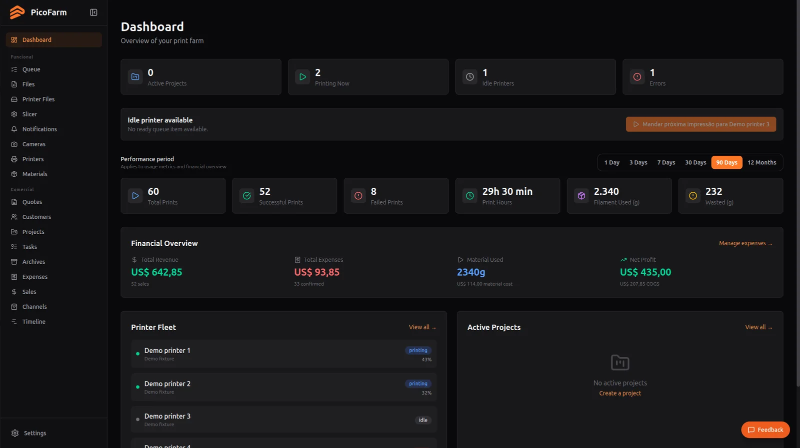
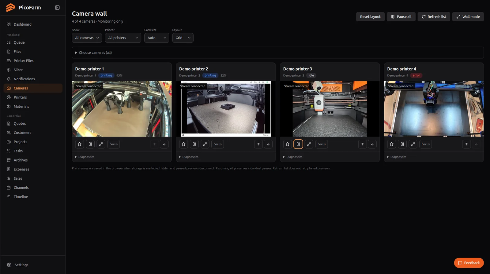
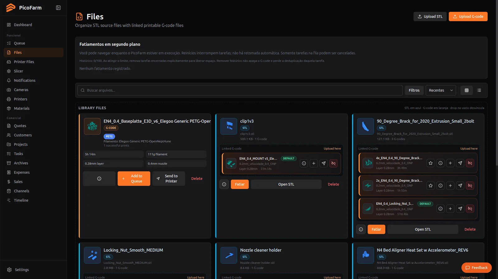
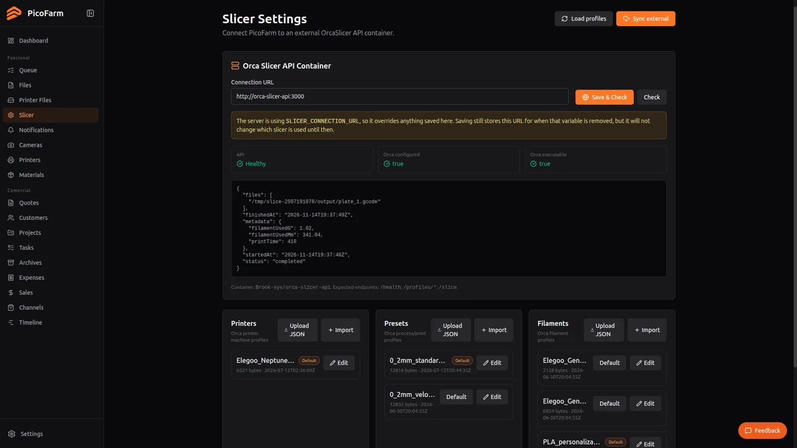
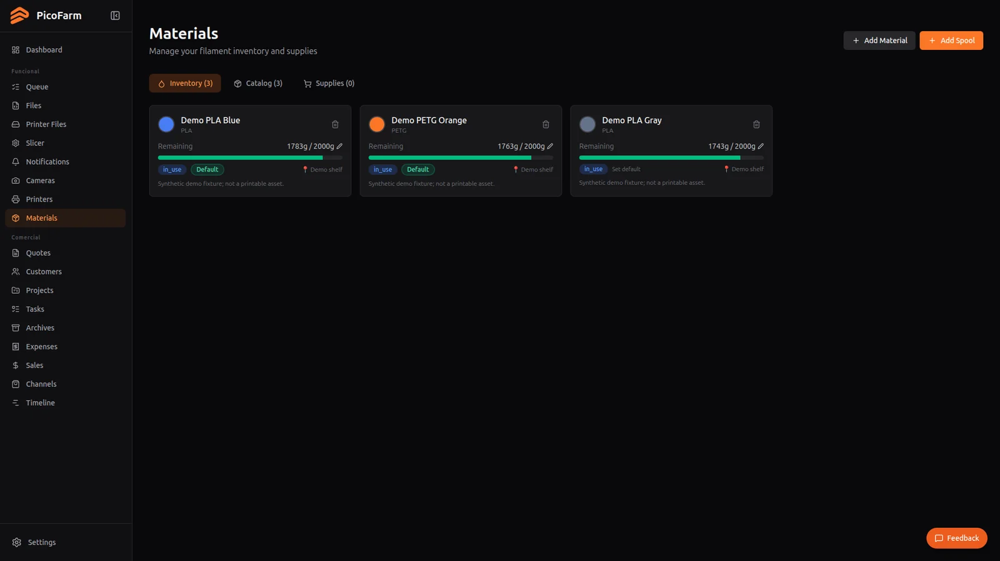

# PicoFarm


Self-hosted print farm management and order fulfillment for makers and small 3D printing businesses.

PicoFarm brings a product catalog, customer orders, production tasks, print queues, and printer status into a browser-based application. A Go server provides the API and serves the production frontend; SQLite stores application data, while uploaded files remain on disk.

[Install with Docker Compose](docs/INSTALL_DOCKER_COMPOSE.md) · [Getting started](docs/GETTING_STARTED.md) · [Screenshots](#a-look-inside)

[](site/public/screenshots/tela_geral_dashboardprincipal.png)

*Your printers at a glance — from a single machine to a small farm.*

## What it does

- **Catalog and production:** projects, parts, design versions, 3MF metadata, tasks, checklists, print jobs, and queues.
- **Printer fleet:** OctoPrint, Bambu Lab LAN/cloud, Moonraker/Klipper, and manual printer records. Controls depend on the printer and protocol capabilities.
- **Files and materials:** G-code/STL libraries, filament spools, supplies, and cost estimates.
- **Sales and fulfillment:** manual orders, customers, quotes, shipping status, expenses, sales, and financial summaries.
- **Integrations:** Etsy and Squarespace, plus partial Shopify support. Mercado Livre and Shopee descriptors are registered but are not live-connectable in the production registry; see [Sales channels](docs/SALES_CHANNELS.md) and [API contracts](docs/API_CONTRACTS.md).
- **Operations:** realtime WebSocket updates, timelines, notifications, database backups, and an optional external slicer service.

A **project** describes a product. An **order item** can generate a **task**, and a task groups the **print jobs** needed to fulfill it. Hardware actions can start real printers: begin with manual printers and test data.

## Quick start from source

Requirements: Git, Make, Go **1.26.11 or newer**, and a Vite-compatible Node.js version (**20.19+ on Node 20, or 22.12+**) with npm. Use a maintained Node.js release.

```sh
git clone https://github.com/Brook-sys/picofarm.git
cd picofarm
go mod download
(cd web && npm ci)
make dev
```

Open **http://localhost:5174** (or the URL printed by Vite if that port is busy). The backend listens on **8084**; Vite proxies `/api` and `/ws` to it. No external integration is required to start.

For a production-style local build:

```sh
make build
./bin/server
```

Open **http://localhost:8084**. Run from the repository root so the server can find `web/dist`. The binary does **not** embed frontend assets.

Read [Getting started](docs/GETTING_STARTED.md) for Docker, configuration, persistent data, troubleshooting, and safe first steps.

## A look inside

A few views of everyday printing workflows. Select any screenshot to open the full-resolution image.

| Camera wall | File library |
| :---: | :---: |
| [](site/public/screenshots/tela_cameras.png) | [](site/public/screenshots/tela_files.png) |
| Keep printer camera views together in one place. | Browse and organize your printable files. |

| Slicer integration | Filament inventory |
| :---: | :---: |
| [](site/public/screenshots/tela_fatiamento.png) | [](site/public/screenshots/tela_filamentos.png) |
| Prepare models with the optional external slicer service. | Keep track of spools and materials. |

*PicoFarm is in BETA. Screenshots illustrate the interface, not a guarantee of printer compatibility or production reliability.*

## Security and data

PicoFarm defaults to local/trusted-network operation, **not hardened public hosting**. Authentication is optional; review the [security model](docs/SECURITY_MODEL.md) before allowing other devices to reach it. The development frontend binds to all interfaces, and the backend listens on the configured port on all interfaces; use firewall rules or an isolated development environment as appropriate. CORS is not access control for non-browser clients.

The default database is `~/.picofarm/picofarm.db`; uploads default to `./uploads`. Keep both, as well as any configured encryption key, when moving an installation. A database backup alone is not a complete file backup. Do not run `make clean` against valuable local uploads: that target deletes `uploads/`.

## Stack and layout

| Area | Implementation |
| --- | --- |
| Backend | Go, chi HTTP router |
| Frontend | React 19, TypeScript 5.9, Vite 7, Tailwind CSS 4, TanStack Query |
| Storage | SQLite with embedded schema and compatibility migrations; local file storage |
| Realtime | WebSocket at `/ws` |
| Packaging | Source build or multi-stage Docker image |

```text
cmd/server/            Server entry point
internal/api/          Routes, handlers, middleware
internal/service/      Business workflows and integrations
internal/repository/   SQLite data access
internal/database/     Embedded schema and migrations
internal/printer/      Printer protocol implementations
internal/realtime/     WebSocket hub
web/                   Application frontend
site/                  Separate marketing/documentation site
```

## Development and documentation

Run these from the repository root:

```sh
make test
(cd web && npm run lint)
make build
```

`make test` runs Go tests only. `make build` builds the backend and runs the frontend TypeScript project build plus Vite bundling. See [Contributing](CONTRIBUTING.md) for change and test expectations.

- [Getting started](docs/GETTING_STARTED.md) — install, run, configure, and preserve data.
- [Project baseline](docs/PROJECT_BASELINE.md) — runtime defaults and validation gates.
- [Architecture](docs/ARCHITECTURE.md) — code boundaries, storage, and migrations.
- [API and data contracts](docs/API_CONTRACTS.md) — routes, JSON conventions, and frontend/backend synchronization.
- [Regression matrix](docs/REGRESSION_MATRIX.md) — workflow checks and automation gaps.
- [Improvements roadmap](docs/IMPROVEMENTS_ROADMAP.md) — prioritized proposals for corrections, frontend performance, and slicer features; not yet implemented.
- [Security model](docs/SECURITY_MODEL.md) and [security policy](SECURITY.md).
- [Documentation index](docs/README.md).

## License

[MIT](LICENSE).
